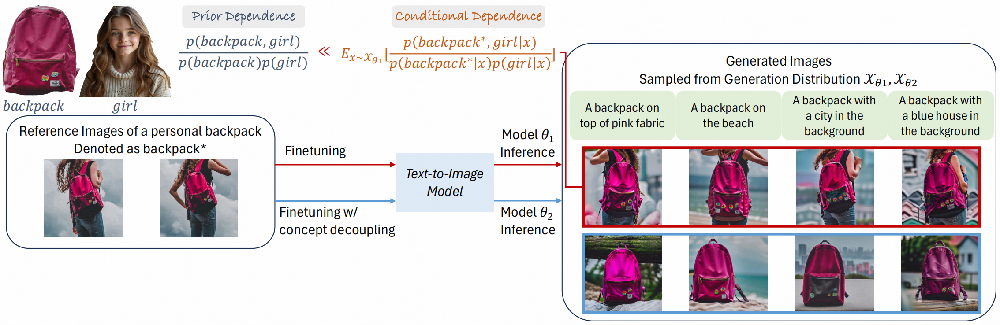

# ACCORD: **A**lleviating **C**oncept **CO**upling through Dependence **R**egularization for Text-to-Image **D**iffusion Personalization
[](https://arxiv.org/abs/2503.01122)

Official implementation of [*ACCORD: **A**lleviating **C**oncept **CO**upling through Dependence **R**egularization for Text-to-Image **D**iffusion Personalization*](https://arxiv.org/abs/2503.01122).

> Image personalization enables customizing Text-to-Image models with a few reference images but is plagued by ”concept coupling”—the model creating spurious associations between a subject and its context. Existing methods tackle this indirectly, forcing a trade-off between personalization fidelity and text control. This paper is the first to formalize concept coupling as a statistical dependency problem, identifying two root causes: a Denoising Dependence Discrepancy that arises during the generative process, and a Prior Dependence Discrepancy within the learned concept itself. To address this, we introduce ACCORD, a framework with two targeted, plug-and-play regularization losses. The Denoising Decouple Loss minimizes dependency changes across denoising steps, while the Prior Decouple Loss aligns the concept’s relational priors with those of its superclass. Extensive experiments across subject, style, and face personalization demonstrate that ACCORD achieves a superior balance between fidelity and text control, consistently improving upon existing methods.


---


## Environment Setup

```bash
git clone https://github.com/antgroup/ACCORD
cd ACCORD
pip install -r requirements.txt
```

## Dataset Preparation

Organize your personalization dataset in a single directory. The directory should contain:

- **Image files**: e.g. `00.jpg`, `01.jpg`, `02.jpg`, … (any naming convention is fine).
- **Config files**: `class_and_name.txt`, `metadata.jsonl`, and `validation_prompts.txt` in the same directory.

Example layout:

```
your_dataset/
├── 00.jpg
├── 01.jpg
├── ...
├── class_and_name.txt
├── metadata.jsonl
└── validation_prompts.txt
```

### File descriptions

**class_and_name.txt**

- Format: one line like: `placeholder,superclass`.
- **placeholder**: A rare word or a word with special characters (e.g. `backpack*`, `cat*`) used to refer to the personalization target in validation prompts.
- **superclass**: A human-defined superclass for the concept (e.g. `backpack`, `cat`).
- Example: `cat*,cat` or `backpack*,backpack`.

**metadata.jsonl**

- One JSON object per line.
- Keys: `"file_name"` (image path relative to this file), `"prompts"` (Caption for that image. Please avoid describing the concepts you wish to personalize, and instead provide a detailed description of the concepts you want to disentangle in the image).
- We recommend obtaining captions with a Vision-Language Model (VLM), e.g. [GLM-4.5V-Thinking-9B](https://huggingface.co/THUDM/glm-4v-9b). Use the following prompt when querying the VLM:

> You are an excellent prompt engineer. Given an image and a tag corresponding to the main object in the image, please describe the given image in short for the text-to-image generation model.
> Note that the prompt you give should consist of a series of phrases, not a complete sentence, and must contain the tag corresponding to the main object. With the aim of decoupling the main target and other information in the image that is unrelated to it, (IMPORTANT) please avoid describing the appearance, attributes like color, or other details of the main object.
> Please do not answer anything other than the prompt. The prompt you give needs to use all lowercase letters. Here is an output prompt example: a girl with curly hair, wearing jeans and carrying a backpack, stands against an overcast sky
> Now, the main object and the image are given: {superclass} {image}

**validation_prompts.txt**

- One validation prompt per line.
- Each line must use the **placeholder** from `class_and_name.txt` to refer to the personalization target.
- Example:

> backpack* in the jungle

## Code Usage

### Download Pretrained Models

For simplicity, we use [Stable Diffusion v1-5](https://huggingface.co/runwayml/stable-diffusion-v1-5) to demonstrate DDLoss and PDLoss. These losses can be easily integrated into other diffusion backbones.

Download the Stable Diffusion v1-5 checkpoint (e.g. via Hugging Face):

```bash
git clone https://huggingface.co/stable-diffusion-v1-5/stable-diffusion-v1-5
```

If you use **PDLoss**, you also need CLIP with the vision encoder:

```bash
git clone https://huggingface.co/openai/clip-vit-large-patch14
```

### Train Custom Diffusion with DDLoss and PDLoss

Edit paths and arguments in [scripts/train_custom_diffusion.sh](scripts/train_custom_diffusion.sh) (e.g. `--pretrained_model_name_or_path`, `--instance_data_dir`, `--output_dir`, `--vision_encoder_path`, `--ddloss_weight`, `--pdloss_weight`), then run:

```bash
bash scripts/train_custom_diffusion.sh
```

### Train DreamBooth with DDLoss

Edit paths and arguments in [scripts/train_dreambooth.sh](scripts/train_dreambooth.sh) (e.g. `--pretrained_model_name_or_path`, `--instance_data_dir`, `--output_dir`, `--ddloss_weight`, `--use_given_prompts`), then run:

```bash
bash scripts/train_dreambooth.sh
```

### Tuning Loss Weights

For optimal performance, a practical approach is to adjust the weights of DDLoss and PDLoss. We recommend tuning the DDLoss weight within the range of 0.05–0.5 and the PDLoss weight within 0.0005–0.003. Empirically, a smaller DDLoss weight combined with a relatively larger PDLoss weight tends to yield better results.

## Citation

If you find our work helpful, please cite our paper.

```bibtex
@misc{liu2025accordalleviatingconceptcoupling,
      title={ACCORD: Alleviating Concept Coupling through Dependence Regularization for Text-to-Image Diffusion Personalization}, 
      author={Shizhan Liu and Hao Zheng and Hang Yu and Jianguo Li},
      year={2025},
      eprint={2503.01122},
      archivePrefix={arXiv},
      primaryClass={cs.CV},
      url={https://arxiv.org/abs/2503.01122}, 
}
```

## License
This project is licensed under the Apache License 2.0. See [LICENSE](LICENSE) for details.
